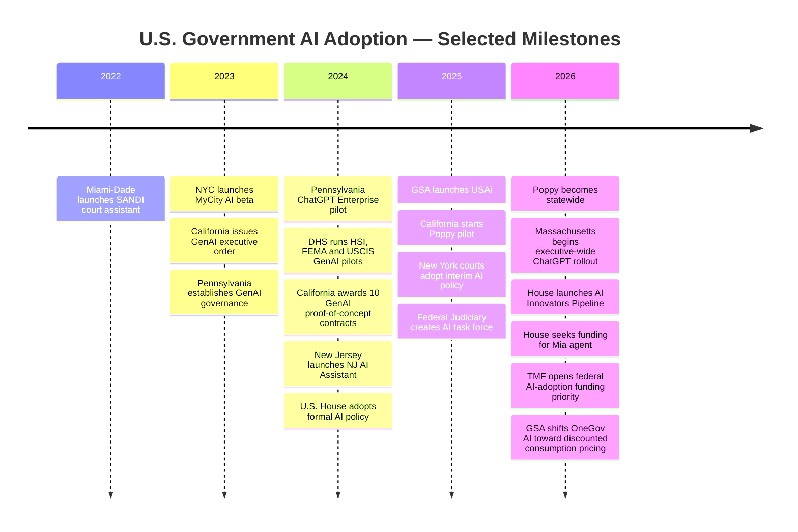
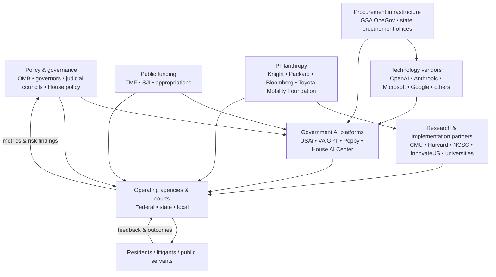

# AI Adoption in U.S. Government: Projects, Pilots, Procurement Programs, and Funding Ecosystem

## Executive summary

As of **November 7, 2026**, AI adoption inside U.S. government has moved beyond isolated experiments into three distinct operating models. The **executive branch is furthest along in enterprise deployment**, with federal and state governments providing secure general-purpose assistants to tens of thousands of employees: VA GPT has roughly 100,000 users; California has moved its Poppy assistant from a 2,800-plus-employee pilot to statewide availability; Massachusetts is rolling ChatGPT out across an executive workforce of roughly 40,000; and Pennsylvania has moved from a controlled ChatGPT Enterprise pilot into approved broader use of ChatGPT Enterprise and Microsoft Copilot. citeturn588624search3turn588624search4turn853346search2turn552808search2turn101128search0

The **legislative branch is adopting AI more institutionally and incrementally**. The U.S. House has created an AI policy, a House AI Center, a secure development sandbox, an AI Innovators Pipeline, and experimental tools such as CaseCompass; a proposed House-wide agent called **Mia — My Intelligent Assistant** would connect to internal House data if appropriations are approved. GAO, meanwhile, operates several mission-specific AI systems and has a late-stage prototype general-purpose GenAI tool for audit and business work. citeturn738541search0turn738541search1turn738541search2turn738541search5

The **judicial branch is more cautious about decision-support AI but is not standing still**. Courts are using AI principally for public access, document summarization, administrative productivity, and self-help rather than autonomous adjudication. Miami-Dade's SANDI chatbot has been operating since 2022; New York's Unified Court System now permits approved private-instance Microsoft AI tools; Arizona is running or authorizing controlled experiments for judges and self-represented litigants; and the federal judiciary has explicitly permitted experimentation while warning courts not to delegate core judicial decision-making to AI. citeturn619427search1turn681919search6turn681919search0turn875727search9turn997906search1

A second structural change is occurring in **procurement**. GSA's USAi and OneGov programs are turning AI acquisition from bespoke agency contracting into reusable governmentwide infrastructure. By late 2026 GSA had announced consumption-based agreements with OpenAI and Anthropic covering federal executive, legislative, and judicial bodies and, through eligible ordering paths, state, local, and tribal governments. GSA reported that its AI agreements had generated approximately **$1.6 billion in estimated federal savings** by October 2026. citeturn101128search8turn634578search6turn634578search7

The strongest published evidence of productivity impact comes from Pennsylvania, VA, San José, and Miami-Dade. Pennsylvania participants reported about **95 minutes saved on days they used ChatGPT**, with more than 85% reporting a positive experience; VA GPT users report **2–3 hours saved per week** and more than 70% report improved job satisfaction; San José's road-condition pilot reported **97% pothole-detection accuracy and 88% debris-detection accuracy**; and SANDI reached 3,545 unique users in its first month and 4,961 in January 2023. These are largely self-reported or project-specific measures rather than controlled estimates of net public-sector productivity, so comparisons should be treated cautiously. citeturn101128search1turn588624search4turn138457search5turn681919search5

A common safeguard architecture is emerging across jurisdictions: enterprise/private model instances; no vendor training on government data; restrictions on PII, PHI or confidential records; mandatory human review; documented risk assessment; audit logging; training; model or vendor approval; and special controls for consequential decisions. California additionally requires GenAI proofs of concept to run in approved sandboxes using public data and to test for bias, hallucination and sensitive-data exposure. citeturn853346search7turn836991search4turn681919search6turn588624search5

**Overall research confidence: 92%.** Confidence is highest for existence, scope, implementing entities, and safeguards because these are documented in primary government sources. Confidence is materially lower for **budgets and vendor contract values**: governments frequently disclose the procurement mechanism but not final AI-specific spending.

## Comparative project landscape

The table concentrates on projects for which there is enough public information to identify an implementing organization, use case and current or historical status. “Not disclosed” means I found no authoritative public figure rather than that the project had no cost.

| Branch / level | Project name | Agency / court | Vendor / partner | Start date | Status as of Nov. 7, 2026 | Budget / cost | Objectives / scope | Safeguards | Source links |
|---|---|---|---|---|---|---|---|---|---|
| Executive / federal | **USAi** | U.S. General Services Administration | Multiple frontier-model providers | Aug. 2025 | **Active** | Platform fee + model usage; initially offered agencies access at no cost | FISMA Moderate environment for federal AI chat, code generation, document work and model evaluation | Standards-aligned government environment; centralized usage controls | citeturn101128search8turn101128search3turn634578search5 |
| Executive / federal | **OneGov AI procurement agreements** | GSA | OpenAI, Anthropic, Google, Perplexity, xAI, resellers | 2025; expanded 2026 | **Active** | OpenAI 2026 agreement: 50% token discount; Anthropic: 40%; earlier introductory per-user offers as low as $0.25–$1 | Governmentwide acquisition of commercial AI without separate bespoke negotiations | Government AI terms, FedRAMP-authorized options, competition/no lock-in emphasis | citeturn634578search5turn634578search6turn634578search7 |
| Executive / federal | **VA GPT** | Department of Veterans Affairs | Internally operated; commercial/open models may underpin platform | Pilot before 2025 | **Active / scaled** | VA estimates about **$1.25/user/month** for early implementation | Secure internal GenAI chat for drafting, summarization and administrative work; ~95,000–100,000 users | VA authentication; approved for VA-sensitive information; prohibition on sensitive data in unauthorized public models; high-impact AI review | citeturn588624search3turn588624search4turn588624search5turn588624search9 |
| Executive / federal | **DHS GenAI pilots — HSI search/summarization** | DHS / Homeland Security Investigations | Open-source/LLM technologies; specific supplier not publicly identified | 2024 | **Pilot completed; deployment decision not publicly confirmed** | Not disclosed | Search large investigative corpora, retrieve relevant documents and summarize leads | Human investigators; testing for accuracy, relevance and reliability; privacy/civil-rights framework | citeturn101128search10turn101128search11 |
| Executive / federal | **DHS GenAI pilot — Planning Assistant for Resilient Communities** | FEMA | Not publicly identified | 2024 | **Pilot completed; evaluation followed** | Not disclosed | Help local governments draft hazard-mitigation-plan elements and improve grant eligibility | Public/researched sources; human customization; RAG evaluation for accuracy and relevance | citeturn101128search10turn101128search11 |
| Executive / federal | **DHS GenAI pilot — USCIS officer training** | USCIS | Not publicly identified | 2024 | **Pilot completed; evaluation followed** | Not disclosed | Personalized training materials for refugee/asylum/international-operations officers | Human instruction retained; metrics included training time and exam performance; model comparisons | citeturn101128search10turn101128search11 |
| Executive / federal | **StateChat** | U.S. Department of State | Department enterprise infrastructure / approved LLMs | By 2024 | **Operational in 2024 inventory; 2026 continuity not independently documented publicly** | Not disclosed | Enterprise GenAI chatbot; search, summarize, translate and draft diplomatic material | Department-approved environment and AI governance | citeturn588624search0turn588624search1turn588624search2 |
| Executive / federal | **NASA-GPT** | NASA Ames / High-End Computing Capability | Internally developed; NVIDIA GPU infrastructure | 2025 | **Internal prototype/deployment** | No cash figure; NASA says internal development avoided hundreds of thousands of dollars in commercial procurement | Search ~3 million technical PDFs and NASA repositories with source-linked answers | Internally hosted; answers link back to source material for verification | citeturn588624search10 |
| Executive / Pennsylvania | **ChatGPT Enterprise pilot** | Pennsylvania Office of Administration + 14 agencies | OpenAI; Carnegie Mellon Block Center research support | Mar. 2024 | **Pilot completed Mar. 2025; broader approved use followed** | Not disclosed | Writing, summarization, policy research, code and administrative productivity; 175 workers | Enterprise isolation; no Commonwealth data used for model training; no PII; human oversight; governing board | citeturn138457search2turn101128search1turn101128search0 |
| Executive / California | **Poppy — California's Digital Assistant** | California Department of Technology | State-built multi-model platform; supports Claude, Gemini, GPT and Nova | Pilot Sept. 29, 2025 | **Statewide active since July 2026** | Not publicly consolidated | Secure GenAI platform for state workforce; pilot involved 2,800+ employees across 67 departments | No model training on state data; PII detection; data stays in California environment; trusted CA.gov sources; vendor-agnostic architecture | citeturn853346search2turn853346search3 |
| Executive / California | **GenAI RFI² proof-of-concept program** | DGS, CDT, Caltrans, CDTFA, CDPH, CalHHS | Accenture, Deloitte, INRIX, Ignyte, SymSoft, Smartling | Jan.–May 2024 | **Ten POCs completed/tested; production disposition varies by project** | Individual contracts publicly posted; no single program total identified | Mobility, vulnerable-road-user analysis, tax call-center assistance, health, language access and related use cases | CDT sandbox; public data for POCs; risk assessment; bias/hallucination testing; sensitive-data scanning | citeturn853346search1turn552808search7turn853346search7 |
| Executive / Massachusetts | **Enterprise AI Assistant / ChatGPT** | Executive Office of Technology Services & Security | OpenAI / Carahsoft | Feb. 2026 | **Active phased rollout** | OpenAI bid materials quoted $3.36M/year for 40,000 seats; final executed contract amount not confirmed in primary announcement | Up to ~40,000 executive-branch employees; drafting, research, translation, summarization | Walled-off environment; no public-model training; state privacy terms; human verification; public ChatGPT/Gemini/Claude prohibited for state work | citeturn552808search2turn552808search3turn836991search4turn552808search8 |
| Executive / New Jersey | **NJ AI Assistant** | NJ Office of Innovation / OIT / Civil Service Commission | State-hosted platform; InnovateUS training partner | July 2024 | **Active** | Not disclosed | Secure sandbox for state workers plus statewide GenAI training | Hosted on state infrastructure; state data not used to train third-party model; privacy, bias and responsible-use training | citeturn836991search5 |
| Executive / New York City | **MyCity AI chatbot** | NYC Office of Technology and Innovation / MyCity | Microsoft Azure/OpenAI; EY | Oct. 2023 | **Active beta** | Not separately disclosed publicly | Answers questions about business permits, licenses, city services, benefits, childcare and careers | Containerized environment; source-grounded responses; agency algorithm-compliance review | citeturn836991search0turn836991search1turn836991search9 |
| Executive / Utah | **MyBusiness AI chatbot** | Utah Division of Technology Services / MyBusiness | Not publicly named | 2026 | **Active beta** | Not disclosed | Public-facing navigator for business registrations, permits, licenses and payments | Responses grounded in official Utah sources; no sensitive information; legal-advice disclaimer; users urged to verify links | citeturn836991search7 |
| Executive / San José | **AI Road Safety Conditions Pilot** | City IT + Transportation Departments | Academic/technology partners including San José State; Toyota Mobility Foundation funder | 2023 | **Phase two active** | **$260,000 Toyota Mobility Foundation grant** for phase two | Detect potholes, debris, parking issues, illegal dumping and other road conditions from vehicle-mounted cameras | Faces, addresses and license plates blurred; city privacy and AI policies apply | citeturn138457search5turn138457search1 |
| Legislative / federal | **House AI Center & AI Innovators Pipeline** | U.S. House CAO / Committee on House Administration | Internal House technical staff; commercial AI platforms as approved | AI Center recommended 2024; Pipeline July 2026 | **Active** | Budget not separately disclosed | Secure sandbox and expert support enabling staff-built tools for schedules, bill summaries, floor monitoring and other workflows | House-wide AI policy, cybersecurity review, approved tools and secure sandbox | citeturn738541search0turn738541search1 |
| Legislative / federal | **CaseCompass** | House CAO + 14 participating Member offices | Internally developed/piloted | 2025 | **Pilot** | Not disclosed | Anonymize, aggregate and analyze constituent casework data | Anonymization; controlled House environment | citeturn738541search12 |
| Legislative / federal | **Mia — My Intelligent Assistant** | House CAO / Modernization & Innovation Subcommittee | To be determined | Funding request July 2026 | **Proposed / funding requested** | Amount not publicly stated in announcement | Secure customizable House agent connected to internal House systems and data | Intended as a secure House-controlled agent; details still under development | citeturn738541search2 |
| Legislative / federal | **GAO AI portfolio / GenAI tool** | Government Accountability Office | Primarily internal | Initial GenAI deployment by 2024 | **Operational systems + late-stage prototype** | Not disclosed | Legislative-mandate detection, survey analysis, audit research, knowledge management, congressional outreach and IT support | AI-supported work must be human-reviewed and grounded in verifiable sources | citeturn738541search5turn738541search6 |
| Legislative / federal | **GPO intranet AI chatbot** | Government Publishing Office | Not disclosed | 2024 | **Development/deployment reported in 2024; current status not separately published** | Not disclosed | Search more than 16,000 indexed internal files and reduce manual searching | Internal use; public technical safeguards not detailed | citeturn738541search7 |
| Judicial / state-local | **SANDI** | Florida Eleventh Judicial Circuit, Miami-Dade | Advanced Robot Solutions; National Center for State Courts; State Justice Institute | July 2022 | **Active deployment** | SJI-supported; award amount not identified in reviewed primary materials | 24/7 bilingual court navigation, Family Court self-help, voice interaction and live-paralegal handoff | Provides information rather than adjudication; human handoff; controlled knowledge base | citeturn619427search1turn681919search5 |
| Judicial / New York | **UCS Microsoft 365 Copilot Chat / Azure AI Services** | New York State Unified Court System | Microsoft | Policy Oct. 2025; amended May 2026 | **Active approved tools** | Copilot Chat listed as available without separate license charge; Azure usage charged by utilization | Summarization, drafting and other judicial/administrative assistance; judges may summarize transcripts under safeguards | Private UCS tenant; approved tools only; mandatory training; human verification; no delegation of judicial decisions | citeturn681919search6turn681919search0 |
| Judicial / Arizona | **AI family-court self-help pilot** | Superior Courts in Maricopa and Graham Counties | Vendor not publicly identified in authorizing order | 2025 | **Authorized pilot; public final results not located** | Not disclosed | Guide self-represented litigants through procedures and family-law forms; test urban/rural scalability | Legal information rather than legal advice; court oversight; statewide AI governance framework | citeturn875727search9turn813863search1 |
| Judicial / Arizona | **Daniel & Victoria AI court reporters** | Arizona Supreme Court | AI-avatar tooling; supplier not identified in court release | Mar. 2025 | **Active public-communications use** | Not disclosed | Produce rapid plain-language video explanations of court opinions and news | Uses court-approved/public information; AI-generated communications remain court-controlled | citeturn875727search10turn875727search0 |
| Judicial / federal | **Federal Judiciary AI experimentation framework** | Administrative Office of U.S. Courts / Judicial Conference | Multiple tools under local Judiciary control | Task force 2025 | **Active experimentation under interim guidance** | Not disclosed | Permit productivity experimentation while developing permanent Judiciary policy | No delegation of adjudication; independent verification; accountability; disclosure consideration | citeturn997906search0turn997906search1 |

Several additional legislative-branch uses exist but remain less transparent. In 2024 the Architect of the Capitol was testing Microsoft Copilot/Azure OpenAI and an AI-powered quality-management/RPA system; U.S. Capitol Police reported AI threat-analysis and video-analysis tools; and the Office of the House Clerk used AI code-generation tools for public websites. citeturn738541search13turn738541search9

One notable terminated example is the State Department's **Crisis Campaign Cable Analytics** project, which used OCR/NLP to analyze diplomatic cables for crisis-training gaps and was explicitly listed as **retired** in the Department's 2024 AI inventory. citeturn588624search0

## What differs by branch

### Executive government: from pilots to shared infrastructure

The dominant executive-branch model has changed from “one use case, one pilot” to **enterprise AI utility**. VA GPT, Poppy, the Massachusetts AI Assistant, the NJ AI Assistant, Pennsylvania's approved tools and USAi all provide generalized capabilities that individual agencies or employees can adapt to many workflows. citeturn588624search4turn853346search2turn552808search3turn836991search5turn101128search0turn101128search8

VA provides perhaps the clearest economic signal. Its 2025–26 strategy says VA GPT cost roughly **$1.25 per user per month** in its early implementation and saved users about **10 hours per month**, while its AI-assisted software-development tooling reportedly saves participating developers more than eight hours per week on average. These are internal survey estimates rather than externally audited productivity studies, but the implied cost/productivity ratio helps explain why governmentwide procurement is accelerating. citeturn588624search9turn588624search4

California illustrates the complementary **sandbox-to-platform** strategy. The state first required GenAI POCs to use isolated CDT-approved environments and public data, then ran ten competitive POCs across transportation, tax, public health and language access, and subsequently built Poppy as a reusable state platform. Poppy now lets departments use multiple model families without locking the state to a single provider. citeturn552808search7turn853346search7turn853346search1turn853346search2

### Legislative government: institution-specific assistants rather than unrestricted consumer AI

Congress is building AI around the peculiarities of legislative data, constituent information and institutional security. The House's 2024 AI policy established formal governance; the House AI Center then added secure experimentation infrastructure, while CaseCompass addresses a specifically congressional problem—extracting insights from constituent casework without simply pooling raw identifiable data. citeturn738541search0turn738541search1turn738541search12

The proposed Mia architecture is especially important because it represents the next stage: an **agent tied to authoritative House systems**, rather than a generic chatbot. The July 2026 announcement describes Mia as capable of finding information, interacting with House systems and supporting custom staff-built skills, but its funding request still required appropriations approval; it therefore should not be counted as an operational deployment. citeturn738541search2

GAO has taken a somewhat different path, building mission-specific systems around legislative mandates, qualitative survey analysis and audit support. Its published guardrail is unusually explicit: AI-generated material affecting engagement work must be **human-reviewed and grounded in verifiable source material**. citeturn738541search5

### Judiciary: assist the process, do not automate the judgment

Judicial adoption exhibits the clearest normative boundary. Federal Judiciary interim guidance cautions courts not to delegate adjudication or core decision-making to AI and requires users to independently verify outputs. California's court rules similarly require accuracy checks, correction of hallucinations, mitigation of biased material and disclosure when a public work consists entirely of GenAI output. citeturn997906search1turn997906search2turn681919search2

New York provides a concrete operational model. Its Unified Court System allows Microsoft 365 Copilot Chat and Azure AI Services only inside UCS-controlled private environments, requires AI training before court-related use, and keeps responsibility for all outputs with the judge or employee. A September 2026 ethics opinion specifically permitted a judge to use private Copilot to summarize hearing transcripts, while emphasizing that the official record—not the AI summary—must remain the basis of adjudication. citeturn681919search6turn681919search0

Court-facing AI has so far been more successful when the task is **navigation rather than legal judgment**. SANDI answers routine court questions and routes people to forms or human paralegals; Arizona's family-court pilot similarly aims to help litigants understand procedures and complete documents while limiting the system to legal information rather than legal advice. citeturn619427search2turn875727search9

## Funding, grants, philanthropy, and procurement support

The funding ecosystem is fragmented. There is no single U.S. “government AI grant.” Instead, different capital sources support different layers: TMF funds federal executive modernization; SJI funds state and local courts; foundations fund local-government capacity; corporate philanthropy funds nonprofit-government AI partnerships; GSA reduces acquisition cost; and private foundations or mobility organizations sponsor discrete municipal pilots.

| Program / sponsor | Funder / operator | Available amount or economic support | Who is eligible | What it can support | Current application/access route |
|---|---|---:|---|---|---|
| **Technology Modernization Fund — Advancing American AI in Agencies** | U.S. Government / GSA TMF | Project-specific; generally repayable investments | Most executive-branch federal agencies under 5 U.S.C. §551; legislative branch and courts are excluded | AI infrastructure, secure adoption capability, modernization necessary to scale AI | 2026 priority call closed Oct. 20, 2026; TMF continues to accept modernization proposals through its proposal process. citeturn410773search7turn410773search8 |
| **State Justice Institute Project Grants** | Federally funded State Justice Institute | Up to **$300,000/36 months** for state courts/national nonprofits; **$200,000/24 months** for local courts; ordinarily 1:1 cash match | State/local courts; qualifying judicial nonprofits, universities and specialist organizations; not federal/tribal courts | Court AI pilots, online court services, demonstrations, training, evaluation | Applications via SJI Grant Management System; quarterly deadlines Nov. 1, Feb. 1, May 1, Aug. 1. citeturn410773search0turn410773search1turn410773search2 |
| **Responsive Cities Network** | John S. and James L. Knight Foundation + Harvard Kennedy School Data-Smart City Solutions | **More than $3 million over three years** | Ten designated Knight communities; fellows embedded initially in Boulder, Philadelphia and San José | GenAI use cases, city data capacity, resident engagement, AI risk assessment | Cohort program rather than an open nationwide grant application. citeturn817694search0turn817694search1 |
| **Google.org Impact Challenge: AI for Government Innovation** | Google.org | **$30 million total**; selected organizations receive **$1M–$3M** plus accelerator support and cloud credits | Nonprofits, social enterprises and academic institutions partnering with governments; global competition including U.S. projects | GenAI/agentic AI applied to public services | 2026 application window closed Apr. 3, 2026; recipients include U.S. projects working with Illinois counties, WMATA, IRS and USACE. citeturn817694search4turn817694search5 |
| **Toyota Mobility Foundation — San José Road Safety** | Toyota Mobility Foundation | **$260,000** phase-two grant | Specific San José project; not a general government application program in the reviewed material | Expanded AI road-condition detection, community outreach and model improvement | Awarded project-specific grant. citeturn138457search5 |
| **Packard Foundation — GovAI Coalition** | David and Lucile Packard Foundation | **$150,000** grant to San José | Project-specific | Staffing and transition of the GovAI Coalition toward nonprofit status | Project award rather than open municipal grant. citeturn634578search11turn634578search0 |
| **GovAI Coalition** | Originated by City of San José; now multi-agency network | San José appropriated **$100,000** in FY2024–25; Packard later awarded $150,000 | Government agencies; academia/nonprofits can participate; private firms have more limited procurement participation | Shared AI policies, procurement standards, vendor accountability, workforce readiness, use cases | Government agencies can join through the Coalition's membership process. citeturn634578search1turn634578search2turn634578search11 |
| **GSA OneGov AI** | GSA + AI vendors | Negotiated discounts rather than grants; e.g. 50% OpenAI consumption discount and 40% Anthropic discount in 2026 | Depending on agreement: federal executive, legislative and judicial organizations plus state/local/tribal buyers | Commercial AI licenses, APIs and enterprise deployments | Procurement through GSA Multiple Award Schedule, resellers/cloud marketplaces and OneGov channels. citeturn634578search6turn634578search7 |
| **InnovateUS public-sector AI training** | InnovateUS / Burnes Center ecosystem with government partners | Training offered **at no cost** in multiple state/city partnerships | Government employees in participating jurisdictions | AI literacy, prompting, procurement, privacy, bias and implementation skills | Jurisdiction-level partnerships; by 2026 programs included Utah, Sacramento and multiple other states/cities. citeturn817694search6turn817694search7turn817694search8 |
| **Bloomberg government-innovation programs** | Bloomberg Philanthropies; Johns Hopkins and other partners | Varies; the 2025 Global Mayors Challenge awarded **$1M each** to 24 winning cities, while City Data Alliance provides technical support rather than a standard AI grant | Participating cities according to each program | Data infrastructure, AI testing, innovation teams and service redesign | Program-specific calls/cohorts rather than a standing AI-only grant. citeturn410773search9turn410773search10 |

SJI is particularly important for courts because its FY2026 guidance explicitly identifies **potential integration of AI into court processes** as an eligible priority and encourages evaluation of both positive outcomes and limitations. SANDI is a concrete example of this funding pathway in practice. citeturn410773search11turn619427search1

The House has its own internal capital source: the **Modernization Initiatives Account**, created in the FY2021 Legislative Branch Appropriations Act to finance improvements in House operations. The July 2026 request for Mia funding was made in that institutional modernization context rather than through an external grant competition. citeturn738541search2

A particularly important 2026 development is that GSA's newer agreements are beginning to bridge governmental levels. The September 2026 OpenAI agreement and October 2026 Anthropic agreement expressly describe eligibility covering federal executive, legislative and judicial users as well as state, local and tribal governments through supported procurement channels. This could make GSA purchasing infrastructure an indirect accelerant of AI adoption beyond the federal executive branch. citeturn634578search6turn634578search7

## Outcomes, safeguards, and evidence quality

The best-documented outcome study is Pennsylvania's year-long ChatGPT Enterprise pilot. About **175 workers across 14 agencies** participated; 48% had not previously used ChatGPT, more than 85% rated their experience somewhat or very positive, and participants reported an average **95 minutes saved on days when they used the system**. Researchers and administrators collected feedback through biweekly sessions, interviews and demonstrations. The evidence is still mainly participant-reported, so it establishes perceived productivity gains more strongly than it establishes causal improvements in service delivery. citeturn101128search1turn101128search9

VA provides evidence at much larger scale but of similar methodological quality. Its inventory reports more than **95,000 VA GPT users**, average self-reported savings of **2–3 hours per week**, and more than 70% reporting improved job satisfaction. The agency's software-development AI tools are used by more than 2,000 developers and reportedly save more than eight hours per week on average. citeturn588624search4turn588624search9

San José supplies a rarer operational-accuracy measure: its vehicle-camera pilot achieved **97% accuracy detecting potholes and 88% detecting trash/debris**, after which the city moved into phase two with Toyota Mobility Foundation support. Personally identifying visual information, including faces and license plates, is automatically blurred. citeturn138457search5

New Jersey reports service-delivery improvements in early departmental AI applications associated with its broader AI-adoption effort: AI-assisted plain-language rewriting of Department of Labor communications was associated with residents responding **35% faster**, while AI analysis of ANCHOR tax-program call-center interactions was associated with a **50% increase in successfully resolved calls**. These metrics should not be attributed specifically to the later NJ AI Assistant platform, but they demonstrate why the state expanded GenAI access. citeturn836991search5

DHS offers a useful model for measuring pilots even where headline results have not been published. USCIS tracked interview-training time and exam scores; HSI measured data-recovery speed and summary quality; FEMA assessed whether generated content satisfied hazard-mitigation-plan requirements. DHS additionally evaluated RAG outputs for accuracy, relevance and reliability and reported pilot metrics monthly to leadership. citeturn101128search10

The emerging safeguard model can be summarized as **“bounded AI + human accountability.”** VA prohibits unauthorized public models from receiving sensitive VA data; Massachusetts requires a segregated enterprise workspace; California scans for PII/PHI/FTI and restricts POC data; New York courts require private UCS-controlled AI and training; House policy embeds cybersecurity review; and federal Judiciary guidance keeps adjudication and accountability with humans. citeturn588624search5turn836991search4turn853346search7turn681919search6turn738541search0turn997906search1

The main unresolved issue is **evaluation quality**. Most government AI programs publish adoption, satisfaction, time-saved or model-accuracy metrics; very few publish randomized comparisons, downstream error rates, total cost of ownership, changes in service equity, appeal rates, employee displacement, energy costs, or independent audits. That makes claims such as “95 minutes saved” useful but insufficient for calculating net social return.

## Timeline of major initiatives

The sequence shows a rapid progression from public-facing chatbots and policy experiments to controlled enterprise deployment and finally to shared procurement and agent infrastructure. The dates below come from the project's own government or program sources. citeturn619427search1turn138457search2turn853346search1turn101128search8turn853346search2turn738541search1turn634578search6

The most consequential inflection appears around **2025–26**: organizations stop treating GenAI only as a pilot application and begin treating it as an **IT layer**. Poppy, VA GPT, USAi, Massachusetts' enterprise deployment, the House AI Center and GSA's consumption-priced OneGov agreements all fit this pattern. citeturn853346search2turn588624search3turn101128search8turn552808search2turn738541search1turn634578search6

## Stakeholder and funding architecture

Across the projects reviewed, AI adoption is rarely a simple agency–vendor transaction. Policy authorities set risk rules; central IT organizations create secure environments; procurement organizations establish contract vehicles; vendors supply models; foundations and grantmakers pay for experimentation or workforce capacity; universities/nonprofits evaluate deployments; and frontline agencies or courts remain responsible for operational decisions. citeturn101128search5turn853346search7turn634578search5turn410773search1turn817694search0turn101128search1

This architecture creates a useful distinction for anyone seeking to promote government adoption. **Federal executive agencies can pursue both direct appropriations/procurement and TMF investment; courts have the unusually targeted SJI pathway; local governments are more dependent on philanthropy, partnerships and ordinary municipal budgets; and vendors increasingly reach governments through centralized procurement rather than individual pilots.** citeturn410773search7turn410773search8turn410773search1turn817694search0turn634578search5

## Research boundaries, gaps, and clarifying questions

This is a **representative national landscape, not a complete census**. Federal executive agencies alone report hundreds of AI use cases—VA's December 2025 inventory contains **367 individual use cases plus 13 consolidated enterprise use cases**—and many state/local governments do not maintain machine-readable public inventories. I therefore prioritized projects with identifiable names, documented deployment or procurement activity, substantive public safeguards, and primary-source evidence. citeturn588624search4

Budget transparency is the largest gap. California publishes individual GenAI contracts; Massachusetts' vendor bid materials reveal proposed seat pricing; San José publishes grant amounts; but many federal projects disclose neither development costs nor ongoing model/API spend. In those cases I have left the figure as “not disclosed” rather than estimating it. citeturn853346search1turn552808search8turn138457search5

Current-status uncertainty also matters. Some older inventories, notably StateChat and several 2024 legislative-branch pilots, establish that a system existed but do not conclusively establish its November 2026 operational status. Those entries are explicitly marked accordingly rather than silently treated as active. citeturn588624search0turn738541search13

Three clarifications would materially sharpen a second-pass version of this research: **Do you want the next iteration to become a near-exhaustive 50-state/local database rather than a representative national landscape? Should “AI projects” include predictive analytics, computer vision and traditional machine learning, or focus primarily on generative/agentic AI? And should the funding section be expanded into an actionable opportunity pipeline limited to programs that are open or expected to reopen in 2027, with applicant type, deadline, match requirement, award size and procurement/application pathway?**

<!-- Diagram images supplied in images/; Mermaid source retained in the main document. -->
